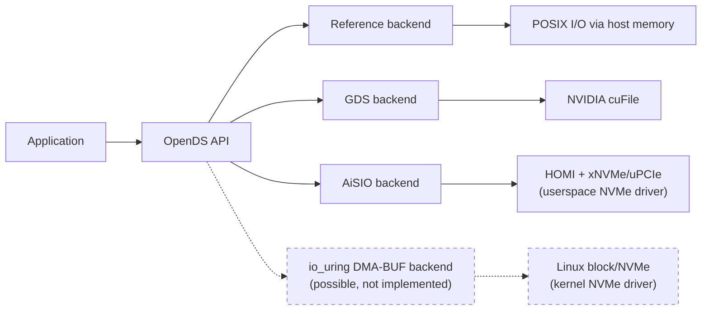
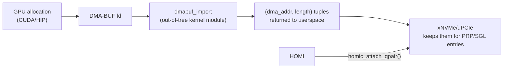
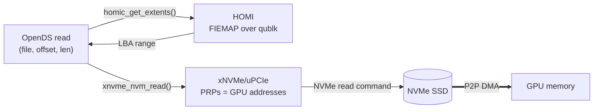
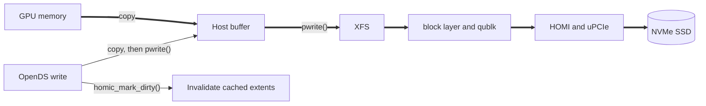
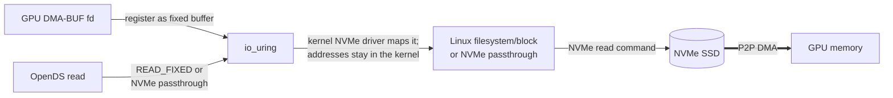

# AiSIO, OpenDS, and io_uring DMA-BUF

Status: working notes, 29 October 2026

## Purpose

These notes capture our current understanding of AiSIO and OpenDS, how the
existing implementation uses DMA-BUF, and how the upstream io_uring DMA-BUF
path could be used. They distinguish the implemented software from the broader
architecture described by the AiSIO documentation.

## Main finding

The current AiSIO implementation does **not** use io_uring DMA-BUF. The
upstream work could be relevant in two ways:

1. compare it with AiSIO's userspace-managed uPCIe path on the same hardware,
   as proposed by the AiSIO future-work page; and
2. use it as a possible future OpenDS backend.

The software integration point would therefore be **OpenDS**, not the existing
AiSIO/HOMI/uPCIe implementation. AiSIO remains the current userspace-managed
backend and provides the comparison baseline.

## What AiSIO and OpenDS are trying to achieve

**AiSIO** explores userspace-managed accelerator storage: userspace owns the
NVMe controller, resolves file extents, and submits NVMe commands that move
data directly between the SSD and accelerator memory.

**OpenDS** gives applications one accelerator-storage API. The selected
backend determines how file data moves between storage and accelerator memory:
through ordinary POSIX I/O, NVIDIA GDS, the current AiSIO/uPCIe path, or a
future upstream io_uring DMA-BUF path.

## OpenDS backends

OpenDS routes I/O to one of several backends. This diagram shows only which
stack each backend uses; the data paths are shown in
[Current AiSIO/OpenDS data paths](#current-aisioopends-data-paths).



## Component summary

- **AiSIO** is the overall accelerator-integrated storage architecture and
  experimental software stack.
- **OpenDS** is the application-facing, cuFile-like storage API.
- **HOMI** (Host-Orchestrated Multipath I/O) is the host control plane for the
  userspace-managed NVMe path.
- **uPCIe** is the userspace NVMe/PCIe driver framework.
- **dmabuf_import** is an out-of-tree kernel module that maps an accelerator
  DMA-BUF and returns its DMA-address segments to userspace.

## Components

### AiSIO

AiSIO is broader than a single I/O implementation. Its documentation compares
and describes accelerator-storage paths along three axes:

1. who manages the NVMe controller: kernel or userspace;
2. who initiates commands: CPU or accelerator;
3. where the data buffer resides: host or accelerator memory.

The documentation discusses a kernel-managed, CPU-initiated P2P path based on
io_uring and DMA-BUF as a comparison point. It is not an implemented AiSIO
component. The implemented P2P backend currently uses xNVMe/uPCIe.

### uPCIe

uPCIe provides small userspace libraries for PCIe discovery, BAR mapping,
DMA-capable memory, and a userspace NVMe driver. In the current AiSIO path it
owns the NVMe PCI function instead of the Linux NVMe driver.

It can:

- initialise and operate NVMe queues from userspace;
- let the CPU construct and submit commands whose buffers are in GPU memory;
- provision GPU-accessible queues so CUDA kernels can submit commands and poll
  completions directly.

Because a PCI function normally has one owner, uPCIe and the kernel NVMe driver
cannot independently own the same function at the same time. AiSIO addresses
coexistence through HOMI with qublk (their ublk-based block device), or
through separate SR-IOV functions.

### DMA-BUF importer

The current uPCIe path uses an out-of-tree module named `dmabuf_import`, exposed
through `/dev/dmabuf_import`.

It turns a GPU DMA-BUF fd into DMA addresses that userspace can put in NVMe
commands. See the setup diagram under
[Current AiSIO/OpenDS data paths](#current-aisioopends-data-paths).

This resembles part of the upstream raw-block implementation, but the ownership
boundary differs:

- in the upstream path, the kernel NVMe driver imports the DMA-BUF and keeps the
  scatterlist/DMA addresses inside the kernel;
- in the uPCIe path, the importer returns the address tuples to userspace
  because the userspace driver constructs the NVMe command descriptors.

The documented OpenDS setup disables the IOMMU; the returned DMA addresses are
then GPU BAR/bus addresses usable by the NVMe controller. AiSIO also has an
experimental IOMMU physical-address mapper and benchmarks for IOMMU-enabled
operation.

### HOMI

HOMI means **Host-Orchestrated Multipath I/O**. It is not a filesystem and is
not a userspace equivalent of blk-mq. In our summary, HOMI is a userspace NVMe
controller manager, queue broker, qublk backend, and filesystem-extent
service.

Its responsibilities include:

- owning and initialising the userspace-managed NVMe controller;
- allocating NVMe queue pairs to CPU and accelerator clients;
- reclaiming those queues when clients detach;
- servicing the qublk device through which Linux can continue to access the
  userspace-owned SSD;
- resolving file extents (`homic_get_extents()`, FIEMAP over the
  qublk-exported block device) for direct-I/O clients; the broader AiSIO
  stack also has XAL for extent resolution;
- coordinating controller and client lifecycle.

Queue allocation is dynamic at client lifetime boundaries, not per I/O. The
current OpenDS code requests a group of queues when its driver instance opens
(`homic_attach_qpair()` with one producer queue plus one per I/O worker), uses
them exclusively while attached, and returns them on detach.

### OpenDS

OpenDS is a userspace accelerator-storage API modelled on NVIDIA cuFile. It is
not a VFS replacement and is not merely a CUDA/HIP selector.

Its stated goal is "Open source accelerator direct storage. Vendor-neutral
API modeled on NVIDIA's cuFile (GDS), powered by aisio". It is its own API,
not a drop-in cuFile replacement: its GDS backend wraps cuFile, and AiSIO is
one of its backends rather than its foundation.

Applications use a common interface to open/register files, manage accelerator
buffers, and perform synchronous, asynchronous, stream, or batch I/O. The
backend architecture is shown above.

CUDA versus HIP determines how accelerator memory is allocated and exported.
The OpenDS backend determines which storage path moves the data.

## Current AiSIO/OpenDS data paths

### Normal filesystem I/O

The SSD is owned by HOMI/uPCIe and re-exported to Linux as a qublk block device.
XFS is mounted on that block device and remains responsible for file layout and
metadata.

```text
application
    -> XFS
    -> Linux block layer
    -> qublk
    -> HOMI/uPCIe
    -> NVMe
```

This is a real read/write filesystem path, not merely a way to call FIEMAP.

In the diagrams below, thin arrows are control (commands, metadata) and thick
arrows are data.

### Setup

Done once per buffer or driver instance, before any I/O:



`dmabuf_import` exists because the NVMe driver is in userspace: it needs bus
addresses for GPU memory to put into NVMe commands. HOMI owns the controller
and hands the client its NVMe queue pairs.

### Direct P2P reads



HOMI only resolves extents. The command goes straight from the client's queue
to the SSD, and the data goes from the SSD to GPU memory without passing
through host memory.

### Writes in the current OpenDS backend

The current OpenDS AiSIO backend does not issue direct P2P NVMe writes from GPU
memory. A write is staged into host memory and sent through `pwrite()`:



This lets XFS allocate blocks, update file size and extents, perform COW, and
maintain metadata normally. The extents are then marked dirty
(`homic_mark_dirty()`) and resolved again before later direct reads.

A direct P2P write to preallocated stable extents is possible in principle, but
it would require coordination with XFS against truncate, hole punching,
reflink/COW, extent relocation, and other mapping changes. The current OpenDS
implementation avoids that problem.

## Where the upstream io_uring DMA-BUF path fits

The upstream path changes the infrastructure and controller owner:



Compared with the AiSIO setup above, `dmabuf_import`, uPCIe and HOMI drop out:
the kernel NVMe driver imports the DMA-BUF itself.

Benefits include retaining normal kernel NVMe ownership, device management,
timeouts, reset handling, and DMA-address isolation inside the kernel. It also
removes the need for the private address-exporting `dmabuf_import` module for
this path.

There are three possible forms:

1. **Raw block:** keep extent lookup and issue READ_FIXED against the
   underlying block device.
2. **NVMe passthrough:** keep extent lookup and issue NVMe reads through
   `io_uring_cmd` on the namespace character device (`/dev/ngXnY`). This most
   closely resembles OpenDS's current LBA-based submission.
3. **Filesystem I/O:** once filesystem DMA-BUF I/O is available, submit against
   the file and let the filesystem own extent translation and updates for every
   I/O.

With the kernel owning NVMe, XFS mounts directly on the kernel NVMe block
device; HOMI/qublk are not needed for this backend. Raw-block or passthrough
direct reads under a mounted XFS still require the same stable-extent
coordination as today. Direct raw writes underneath a mounted XFS remain
unsafe, so writes would still go through the filesystem.

### Upstream status

- Raw block: in Jens' `for-7.4/io_uring-dmabuf` (and `for-next`), targeting
  the 7.4 merge window; not merged yet.
- NVMe passthrough: v2 posted.
- Filesystem I/O: RFC posted, v2 in progress.

### Current upstream limits

- No IOPOLL for DMA-BUF registered buffers.
- `O_DIRECT` required.
- DMA-BUF size must not exceed `UINT_MAX` bytes, effectively just under 4 GiB
  (the bio offset is 32-bit).
- Devices with integrity checksums are rejected.
- Each DMA-BUF registration context is currently bound to one target file.

## Public future-work statement

The AiSIO future-work page says that stabilization of the mainline io_uring and
DMA-BUF path makes "a direct comparison between the kernel-managed and user
space managed P2P architectures" possible on identical hardware.

## Sources

- [AiSIO architecture](https://xnvme.io/aisio/architecture.html)
- [AiSIO current implementation](https://xnvme.io/aisio/implementation.html)
- [AiSIO future work](https://xnvme.io/aisio/future_work.html)
- [OpenDS repository and backend description](https://github.com/xnvme/opends)
- [OpenDS AiSIO backend source](https://github.com/xnvme/opends/blob/5c3c9517100333899ea2e2aee9079d8fd7e0c9da/src/opends_aisio.c)
